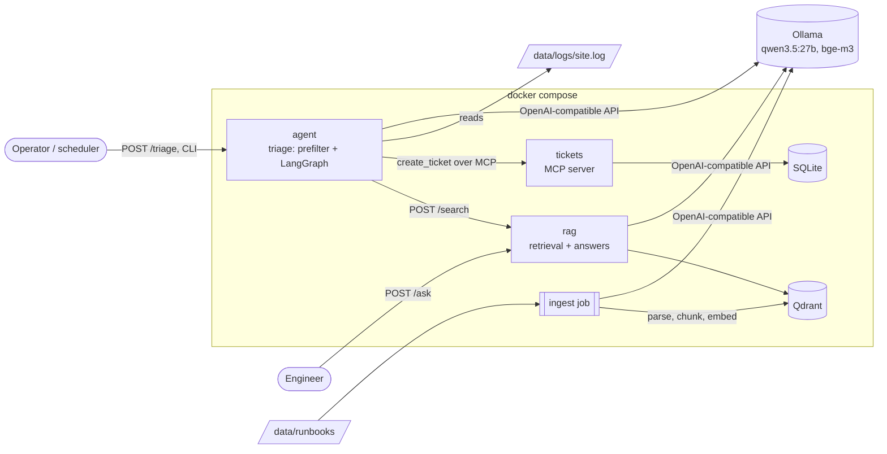

```bash
cp .env.example .env            # then set TICKETS_API_KEY and AGENT_API_KEY, 16+ characters each
```


# Site Ops Assistant

An on-call assistant for a small production site, built as three Python microservices:

- **Ask**: answers questions from the site's runbooks, with citations that are checked against the retrieved text. When the runbooks don't support an answer, it says "I don't know".
- **Triage**: reads a time range of logs, finds the suspicious windows, has an LLM agent diagnose each one with the runbooks, and opens deduplicated incident tickets over MCP.

Everything runs locally: Qdrant for vectors, Ollama for the embedding model and the LLM, SQLite for tickets. The LLM's tool calls and citations are checked by code before anything is accepted.

## Contents

- [Architecture](#architecture)
- [How a request flows](#how-a-request-flows)
- [Design principles](#design-principles)
- [Getting started](#getting-started)
- [Configuration](#configuration)
- [Development](#development)
- [Evaluation](#evaluation)
- [Repository layout](#repository-layout)
- [Status and limitations](#status-and-limitations)

## Architecture



| Service                                           | What it does                                                                   | Owns                                 | Host port | Stack                                 |
| ------------------------------------------------- | ------------------------------------------------------------------------------ | ------------------------------------ | --------- | ------------------------------------- |
| [`services/rag`](services/rag/README.md)         | Ingests runbooks; serves `/search` and `/ask`                              | The vector store                     | 8000      | FastAPI, Docling, Qdrant              |
| [`services/agent`](services/agent/README.md)     | Triages logs into tickets; serves `/triage` and `/windows`, plus a CLI     | Nothing: it calls the other services | 8001      | LangGraph, LangChain, FastAPI         |
| [`services/tickets`](services/tickets/README.md) | MCP server with one tool, `create_ticket`, deduplicated by fault and host    | The ticket store                     | 8002      | MCP Python SDK, SQLite                |
| [`packages/common`](packages/common/README.md)   | The wire contracts shared by the services (pydantic models)                    | —                                   | —        | pydantic                              |
| Qdrant                                            | Vector database                                                                | `qdrant-data` volume               | 6333      | `qdrant/qdrant:v1.20.0`             |
| `ollama`                                        | The model server: a forwarder to your host's Ollama, or Ollama itself on a GPU | —                                   | —        | `alpine/socat` or `ollama/ollama` |

Every port is published on `127.0.0.1` only.

**Why three services?** rag sits next to its data and has two clients: engineers and the agent. The agent reads untrusted log text, so it is kept away from the vector store and the database. A prompt-injected agent can only search runbooks and file tickets, and the tickets service deduplicates those. Tickets speaks MCP over HTTP in its own container, so its code and dependencies stay out of the agent's image.

## How a request flows

**Ask.** `POST /ask {"question": "..."}` → embed the question → top-k chunks from Qdrant (k = 10 by default) → the LLM gets numbered excerpts and must reply in JSON, giving its citations as `{excerpt, quote}` → code keeps a citation only if the excerpt was retrieved and the quote appears in it word for word → no surviving citation means `answered: false`, "I don't know".

**Triage.** `POST /triage {"since", "until"}` (or the CLI) → read the log lines of `[since, until)` → a deterministic prefilter (regex and threshold rules) groups suspicious events into per-host windows → for each window, a LangGraph loop lets the model call `search_runbooks` and `log_context`, then finish with `create_ticket` or `dismiss` → code checks the model's draft (evidence must be real line numbers, the runbook a chunk it retrieved, the host one seen in the logs) and fills in the facts itself → the ticket goes to the tickets service over MCP → the run returns a `TriageReport` with one outcome per window. The loop's routes and every possible tool call, with what the model reads back, are in the [agent README](services/agent/README.md#the-agent-loop).

## Design principles

- **The model points, code fills and checks.** The LLM never writes evidence, timestamps or citations directly. It points at line numbers and retrieved chunks, and code checks the pointers and copies the facts. A failed check goes back to the model as a refusal it can correct.
- **Logs are untrusted input.** Only the prefilter's windows reach the model, every ticket field has a length limit, and `suggested_fix` is advice for a human that no service ever executes.
- **Every external technology sits behind an interface.** Each interface (`abc.ABC`) has a real adapter and a fake, so the whole pipeline runs in unit tests without a model, Qdrant or a network. The agent uses LangChain's `BaseChatModel` as its model interface instead of wrapping it.
- **One composition root per service.** `container.py` is the only module that reads settings and picks adapters. Everything else receives its dependencies.
- **Settings in YAML, secrets in `.env`.** Each service's `config.yaml` holds every non-secret setting, with no environment overrides and no code defaults. Secrets come only from `.env` or environment variables.
- **Shared wire contracts.** Request, response and ticket models live in `packages/common`, so the services can't disagree on them. Changes there must be backward compatible.

Every choice, with its reasons and costs, is recorded in [`docs/DECISIONS.md`](docs/DECISIONS.md).

## Getting started

### Prerequisites

- Docker with Compose v2, and `make`
- [uv](https://docs.astral.sh/uv/) (Python 3.12 is installed by uv from `.python-version`)
- A model server with both models:
  - **On the host (default):** [Ollama](https://ollama.com), then `ollama pull qwen3.5:27b` and `ollama pull bge-m3`. Any OpenAI-compatible server works: set `LLM_UPSTREAM` in `.env`.
  - **In the stack on an NVIDIA GPU:** use `make up-gpu` and `make models` instead of `make up` below.

### Run the stack

```bash
cp .env.example .env            # then set TICKETS_API_KEY and AGENT_API_KEY, 16+ characters each
uv sync                         # the dev environment, for the scripts and tests
make generate-logs              # data/logs/site.log and ground_truth.json (seed 42, 4 hours)
make up                         # build and start qdrant, rag, tickets, agent; waits until healthy
make ingest                     # parse, chunk and embed the 30 runbooks into Qdrant (once)
```

Generate a key with `python -c "import secrets; print(secrets.token_hex(16))"`. `make help` lists every target.

### Try it

The agent's routes need its key, so first load `.env` into your shell (`set -a; . ./.env; set +a`).

```bash
# Ask the runbooks
curl -s localhost:8000/ask -H 'Content-Type: application/json' \
  -d '{"question": "What should I check before a PostgreSQL failover?"}'

# Preview the windows the prefilter finds (no LLM call)
curl -s "localhost:8001/windows?since=2026-11-01T06:00Z&until=2026-11-01T10:00Z" \
  -H "Authorization: Bearer $AGENT_API_KEY"

# Triage one fault's time slot (the disk_full fault), without filing anything
make triage SINCE=2026-11-01T07:00Z UNTIL=2026-11-01T07:15Z DRY_RUN=1

# Or queue a run over HTTP and follow it
curl -s localhost:8001/triage -H "Authorization: Bearer $AGENT_API_KEY" \
  -H 'Content-Type: application/json' -d '{"since": "2026-11-01T06:00Z", "until": "2026-11-01T10:00Z"}'
curl -s localhost:8001/triage/<run_id> -H "Authorization: Bearer $AGENT_API_KEY"
```

The seeded faults and their time slots are listed in `data/logs/ground_truth.json`. `make down` stops the stack and keeps the volumes (runbooks, tickets, models). `docker compose down -v` removes them too.

## Configuration

| File                                                    | Read by                 | Holds                                                                            |
| ------------------------------------------------------- | ----------------------- | -------------------------------------------------------------------------------- |
| `.env` (from `.env.example`)                        | docker compose          | `TICKETS_API_KEY`, `AGENT_API_KEY`; optional `LLM_UPSTREAM` and host ports |
| `services/<service>/config.yaml`                      | the service on the host | Every non-secret setting: URLs, models, budgets, timeouts, paths                 |
| `services/<service>/config.docker.yaml`               | the service's image     | The same settings as seen from inside the compose network                        |
| `services/<service>/.env` (from its `.env.example`) | the service on the host | That service's secrets                                                           |

A setting missing from the YAML stops the service at startup, and a secret found in the YAML is an error. To use another file, point `RAG_CONFIG_FILE`, `AGENT_CONFIG_FILE` or `TICKETS_CONFIG_FILE` at it. Each service's README lists its settings.

## Development

```bash
uv sync --all-extras            # every adapter's dependencies (Docling, Qdrant client, MCP, LangChain OpenAI…)
make test                       # unit and contract tests: fast, no network, no model
make test-integration           # tests against real Qdrant, Ollama and rag; each skips what isn't running
make lint                       # ruff check and ruff format --check
make typecheck                  # mypy, strict, on every src/ folder
```

| Tier              | Marker          | Needs                      | Where                                                                                  |
| ----------------- | --------------- | -------------------------- | -------------------------------------------------------------------------------------- |
| Unit and contract | (default)       | nothing                    | `*/tests/unit/`, `packages/common/tests/`, `tests/test_stack.py`, `tests/e2e/` |
| Integration       | `integration` | Qdrant, Ollama, the models | `services/rag/tests/integration/`                                                    |
| Eval              | —              | the whole stack            | `scripts/run_eval.py`                                                                |

The contract suites run one set of tests over every implementation of an interface: memory and Qdrant for the vector store, memory and MCP for the ticket sink, memory and file for the log source. `tests/e2e/` runs the agent's real clients against the real rag and tickets apps in-process. `tests/test_stack.py` fails if the compose file, Dockerfiles and configs disagree on ports, service names or mounts.

To run one service from source while the rest stay in compose, stop its container and start it from the host. The `config.yaml` URLs point at the ports compose publishes.

```bash
docker compose stop agent
uv run python -m siteops_agent.api.main
```

**CI** (GitHub Actions, on every pull request and push to `main`) runs `ruff check`, the unit tier, and a job with all extras that runs mypy and the integration tier against a Qdrant service container. The eval and `ruff format --check` are not in CI.

## Evaluation

**Retrieval** is scored against `data/golden_set.jsonl`: 91 hand-written questions about 10 of the 30 runbooks. The other 20 are distractors, about a third of them near-misses (MySQL next to PostgreSQL failover, internal CA next to public TLS). A hit is a chunk from the expected runbook and section, so labels survive chunking changes.

```bash
uv run python scripts/run_eval.py               # recall@k and MRR at the configured top_k
uv run python scripts/run_eval.py --top-k 5     # at another depth
uv run python scripts/run_eval.py --ask         # also score /ask: answer rate, citation accuracy, false answers
```

Each run is appended to `data/eval_history.jsonl` with its configuration and git commit. Current numbers (bge-m3, 1000-character chunks, no reranker):

| top_k | recall@k | MRR   |
| ----- | -------- | ----- |
| 3     | 0.945    | 0.839 |
| 5     | 0.956    | 0.841 |
| 10    | 0.989    | 0.846 |

**Triage** has ground truth but no scorer yet. `scripts/generate_logs.py` seeds seven faults, each mapped to its runbook, plus harmless decoys, and writes `data/logs/ground_truth.json`. The matching rule for ticket precision, recall and duplicates is specified in `docs/DECISIONS.md` (scope/4). The prefilter's recall on generated logs is checked by a unit test: every seeded fault opens a window.

## Repository layout

```
├── packages/common/        shared wire contracts (siteops-common)
├── services/
│   ├── rag/                ingestion, /search, /ask (siteops-rag)
│   ├── agent/              triage: CLI and HTTP API (siteops-agent)
│   └── tickets/            MCP ticket server (siteops-tickets)
├── tests/                  cross-service: e2e, stack consistency; eval/ (empty for now)
├── scripts/                ingest.py, generate_logs.py, run_eval.py
├── data/                   runbooks/, logs/, golden_set.jsonl, eval_history.jsonl
├── docs/DECISIONS.md       decision log
├── docker-compose.yml      the stack; docker-compose.gpu.yml puts Ollama in it on a GPU
├── Makefile                make help
└── pyproject.toml          the uv workspace, ruff, mypy and pytest settings
```

It's a uv workspace with one lockfile. Each service is its own package with its own dependencies and Docker image, built from the repo root. The annotated file tree is in [`AGENTS.md`](AGENTS.md).

## Status and limitations

What this version doesn't do yet:

- **No reranker.** Retrieval is vector search only. Recall@10 is 0.989, but there is no measurement of what a cross-encoder would add at a smaller k.
- **No triage scorer.** The ground truth and matching rule exist, but `tests/eval/` is empty.
- **No chat or UI.** The agent serves triage only. A chat mode on the same tools is designed but not built.
- **Single-process agent API.** The run queue (5 waiting, 1 running) and the last 50 reports live in memory, so a restart forgets reports, but not the tickets they filed.
- **Shared API keys, no access levels.** One key per service, and every caller sees every runbook.
- **Manual triggers.** No scheduler or log watcher: a run takes an explicit `[since, until)` range.
- **Prefilter blind spot.** A host that goes silent produces no window. It is only caught through its symptoms on other hosts.
- **Golden set without categories.** Per-category recall and the false-answer rate on unanswerable questions are supported by the eval script, but the golden set has neither yet.
