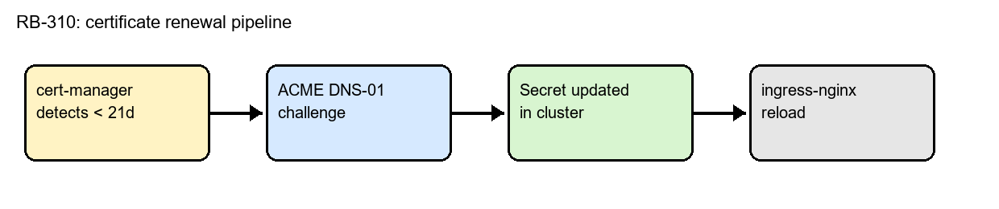

# RB-310: TLS Certificate Expiry

| Field         | Value                                 |
|---------------|---------------------------------------|
| Service       | ingress-nginx (all public endpoints)  |
| Severity      | SEV-2 (SEV-1 if already expired)      |
| Owner         | Edge Networking team                  |
| Last reviewed | 2026-10-02                            |

## 1. Symptoms

- Alert **CertExpiringSoon** fires when a certificate has fewer than **14 days** left.
- Browsers show `NET::ERR_CERT_DATE_INVALID` once the certificate has expired.
- Synthetic checks from `probe-eu-1` fail with `x509: certificate has expired`.

## 2. How renewal normally works



*Figure 1: cert-manager renews 21 days before expiry using an ACME DNS-01 challenge.*

If the alert fires, the automatic renewal above has already failed at least once.

## 3. Diagnosis

### 3.1 Check the certificate status

```bash
kubectl get certificate -A
kubectl describe certificate api-example-com -n edge
```

### 3.2 Common failure causes

| Cause                        | Signal in `kubectl describe`            | Fix                                 |
|------------------------------|-----------------------------------------|-------------------------------------|
| DNS API token expired        | `403 Forbidden` from DNS provider       | Rotate token, see section 4.1       |
| ACME rate limit hit          | `too many certificates already issued`  | Wait 1 hour or use the staging CA   |
| Wrong ClusterIssuer          | `issuer not found`                      | Fix `issuerRef` in the Certificate  |

## 4. Remediation

### 4.1 Rotate the DNS API token

1. Create a new token in the DNS provider console with the `Zone:DNS:Edit` scope.
2. Update the secret:
   ```bash
   kubectl -n cert-manager create secret generic dns-api-token \
     --from-literal=token=<NEW_TOKEN> --dry-run=client -o yaml | kubectl apply -f -
   ```
3. Trigger a renewal:
   ```bash
   cmctl renew api-example-com -n edge
   ```

### 4.2 Verify

- `kubectl get certificate api-example-com -n edge` shows `READY=True`.
- The new expiry date is about 90 days away:
  ```bash
  echo | openssl s_client -connect api.example.com:443 2>/dev/null | openssl x509 -noout -enddate
  ```

> **Warning:** do not delete the `Certificate` resource to force a renewal. That removes the
> secret and causes an outage until a new certificate is issued.

## 5. Escalation

| Level | Who                      | Contact                 |
|-------|--------------------------|-------------------------|
| L1    | On-call SRE              | #ops-oncall             |
| L2    | Edge Networking on-call  | PagerDuty: edge-net     |

See also: [RB-415 High API latency](runbook_high_latency.txt).
