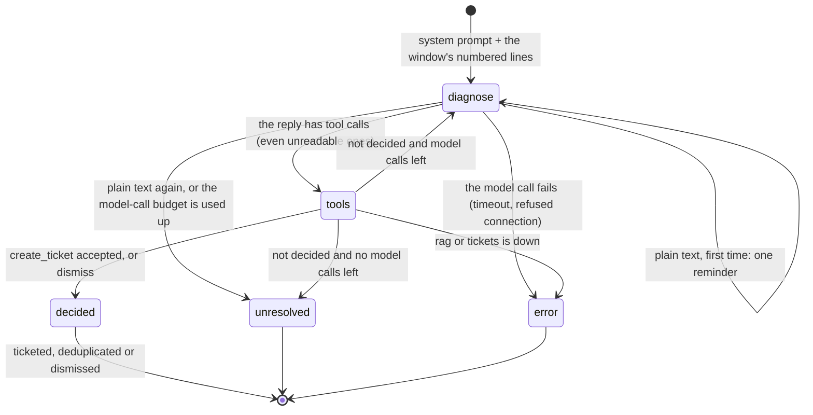

# agent

The log-triage agent. Given a time range, it reads the site's logs, finds the windows worth a look, has an LLM diagnose each one using the runbooks, and opens incident tickets for the real faults. It dismisses the noise and returns a report of every decision.

The agent owns no data. Runbook search is a call to rag's `/search`, and ticket creation is a call to the tickets service over MCP. It reads logs from a file today, through an interface that hides the source.

It has two entry points running the same job: a **CLI** for a scheduler, the eval or a person, and an **HTTP API** that queues runs.

## How a triage run works

```
[since, until) ─► LogSource ─► LogEvents ─► prefilter ─► Windows ─► for each window: TriageAgent ─► TriageReport
                  (file)       (parsed)     (rules)      (per host)  LangGraph loop, budgets       one outcome per window
```

1. **Read.** `FileLogSource` returns the parsed events of `[since, until)` in time order, plus a count of unparsable lines. The same range always gives the same events, which makes runs repeatable.
2. **Prefilter.** Deterministic, no LLM. Nine rules (`prefilter.py`, `RULES`) group matching events into windows per host and rule. Pattern rules fire on one line (`No space left on device`, `OOMKilled`); threshold rules need several matches in a span (five slow requests in 5 minutes). A catch-all takes any ERROR no other rule matched.
   - Each window carries 5 events of context before its first match and 2 after its last, capped at 50 events.
   - The rule's name is a hint for the model, not a verdict.
3. **Diagnose.** Each window gets a fresh LangGraph loop, `diagnose ⇄ tools`. The model must end it with a terminal tool:

   | Tool | What it does | Budget per window |
   |---|---|---|
   | `search_runbooks(query)` | rag `/search`; returns the top passages with their `chunk_id` | 3 searches, 3 hits each |
   | `log_context(host, components, min_level, pattern, before, after)` | More events from this run, for any host. `pattern` is a regex on the message, with a 100 ms budget. | 2 queries |
   | `create_ticket(...)` | Ends the window with a ticket draft (below) | — |
   | `dismiss(reason, looks_like)` | Ends the window: transient or harmless. `looks_like` names the fault it resembles, which helps debug decoys. | — |

   The window gets at most 8 model calls. A model that answers in plain text gets one reminder. A window that runs out of budget is reported `unresolved` and never ticketed. [The agent loop](#the-agent-loop) below covers every route and every possible tool call.
4. **Check, then file.** The model's draft holds its judgement only: fault type, severity, title, summary, suggested fix, host, evidence as **line numbers** and the runbook as a **`chunk_id`** it retrieved. Code checks every line number, the `chunk_id` and the host (one that wrote a line in this run). A failed check goes back to the model as a refusal it can correct.
   - Code then fills the facts (raw evidence lines, window times, the full runbook reference) to build a `TicketCreate`, and sends it through the `TicketSink`.
5. **Report.** A `TriageReport` lists, per window: its status, the draft and ticket ID or the dismissal, the searches and the runbooks they offered, the log lookups, the rejected drafts, the model calls and the duration. Every window's full transcript is logged.

| Window status | Meaning |
|---|---|
| `ticketed` | A new ticket was opened |
| `deduplicated` | The tickets service returned an open ticket for the same fault type and host |
| `dismissed` | The model closed the window without a ticket |
| `unresolved` | The budget ran out without a decision |
| `error` | rag, tickets or the model failed; the window wasn't decided, and the run goes on |

## The agent loop

One window gets one LangGraph `StateGraph` (`agent.py`) with two nodes. `diagnose` calls the model with the conversation so far and the four tools bound. `tools` runs every tool call in the model's last reply and appends one result per call. The routes between them are small pure functions (`after_diagnose`, `after_tools`), unit-tested without a model.



- **The conversation starts** with the system prompt (the rules, the fault types, how to decide) and the window: its lines numbered `1…N`, its host, its span and the rule that opened it.
- **Several tool calls in one reply** are run in order, and each gets its own result. A call is never skipped: an unknown tool name or arguments that aren't valid JSON get a refusal like any other.
- **The budget counts model calls**, not tool calls. One reply may search twice; that is one model call and two of the 3 searches. LangGraph's recursion limit (`2 × max_llm_calls + 2`) is only a backstop: the routes always end the window first.
- **Two kinds of failure are kept apart.** The model's mistakes (bad arguments, a failed check, a used-up budget) come back to it as refusals, and the window goes on. Our failures (rag or tickets unreachable, the model call itself failing) end the window as `error` and are kept from the model, so it doesn't retry something it can't fix.

### Every tool call and what the model reads back

| Call | Arguments (what the model fills) | Reply on success | Refused (the window goes on) | Ends the window as `error` |
|---|---|---|---|---|
| `search_runbooks` | `query` (≤ 300 chars) | Up to 3 passages, each as `chunk_id=…`, `source=…`, `section=…`, then its text. Or `No runbook passage matches.` | `search budget used (3 searches): decide with the passages you have`; invalid arguments | rag unreachable or failing |
| `log_context` | `host`, `components` (≤ 10), `min_level`, `pattern` (regex on the message, ≤ 200 chars), `before`, `after` (0–20, default 10); all optional | Matching events around and inside the window, **numbered after the lines already shown**, so they can be cited as evidence | `log_context budget used (2 calls): decide with the lines you have`; an invalid or too-slow pattern (100 ms budget) | — (reads this run's events only) |
| `create_ticket` | `fault_type`, `host`, `severity`, `title`, `summary`, `suggested_fix`, `evidence_lines` (1–20 line numbers), `runbook_chunk_id` (or `null`) | `Ticket <id> opened. The window is done.` or `Already open as <id> (the same fault on the same host). The window is done.` | `Ticket refused: <every problem>. Fix it and call create_ticket again, or dismiss.` (examples below) | tickets unreachable or failing |
| `dismiss` | `reason` (≤ 1000 chars), `looks_like` (a fault type, optional) | `Dismissed. The window is done.` | Invalid arguments | — |
| any tool, after a decision | — | — | `This window is already decided: stop.` | — |
| an unknown tool, or unreadable JSON | — | — | `Call refused: there is no tool '…'` / `the arguments of '…' could not be read` | — |

The checks behind `Ticket refused`, all reported at once:

- `host 'orders-db' is not a server in these logs: name the server that is at fault`
- `host '…' does not appear in the lines shown: name a host that does`
- `evidence_lines [57] do not exist: the lines shown are 1 to 42`
- `runbook_chunk_id '…' was not returned by search_runbooks: use one that was, or null`

When the draft passes, code builds the `TicketCreate` itself: the evidence lines' raw text, the window's start and end, and the full runbook reference of the retrieved chunk. The model never writes those.

### A typical window

This example is illustrative, shaped on the tool probe recorded in `docs/DECISIONS.md` (agent/4). It is a `pg_primary_down` window opened on the replica by the `db_leader_unreachable` rule:

| # | Node | What happens |
|---|---|---|
| 1 | `diagnose` | The model reads 12 numbered `patroni` lines from `db-replica-02`: the leader is unreachable, and there's no automatic failover. It calls `search_runbooks("postgres primary unreachable replica no automatic failover")`. |
| 2 | `tools` | rag returns 3 passages, including `runbooks/runbook_db_failover.docx`'s diagnosis section, with its `chunk_id`. |
| 3 | `diagnose` | It calls `log_context(host="db-primary-01", before=10, after=5)` to check the primary. |
| 4 | `tools` | The primary has been silent since the fault began. The lines returned show `write failed … recovery mode` on the API hosts, numbered 13 onwards. |
| 5 | `diagnose` | It calls `create_ticket(fault_type="pg_primary_down", host="db-primary-01", severity="SEV-1", evidence_lines=[3, 7, 15], runbook_chunk_id="…", …)`. |
| 6 | `tools` | The checks pass: `db-primary-01` wrote lines earlier in the run, and the replica's lines shown name it. Code builds the ticket and files it over MCP. `Ticket … opened.` The window ends as `ticketed`, after 3 model calls. |

Had the model filed `host="orders-db"` (a service named in the API errors), step 6 would have been `Ticket refused: host 'orders-db' is not a server in these logs…`, and the model would get another model call to correct it. Every window's full transcript is in the log: the tools as offered, every message, every call and result, and the outcome.

## Safety model

Log lines are untrusted input: anyone who can make a service log a string can put text in front of the model. The agent limits what that text can achieve:

- Most log text never reaches the model: only prefilter windows and bounded `log_context` results do.
- The model's only side effect is a ticket. Tickets are deduplicated by the tickets service, a boundary the agent can't bypass, and every field has a length limit.
- The model can't invent evidence or citations: it can only point at lines it was shown and chunks it retrieved.
- `suggested_fix` is advice for a human, and no service ever executes it.
- Our own failures (rag or tickets down) end the window as `error` and are kept from the model. Its own mistakes come back as refusals it can correct.

## CLI

```bash
uv run python -m siteops_agent.cli --since 2026-11-01T07:00Z --until 2026-11-01T07:15Z [--dry-run] [--report FILE] [--log FILE]
# in the stack:
make triage SINCE=2026-11-01T07:00Z UNTIL=2026-11-01T07:15Z DRY_RUN=1
```

| Flag | Meaning |
|---|---|
| `--since`, `--until` | The range `[since, until)`, ISO 8601 with a timezone |
| `--dry-run` | Tickets go to a fresh in-memory sink with the same dedup rule: nothing is filed |
| `--report FILE` | Write the JSON report here instead of stdout |
| `--log FILE` | Write the log (each window's transcript) here instead of stderr |

The totals line goes to stderr. Only a run that can't start fails. A window that fails is reported as `error`.

## HTTP API

Every route except `/health` needs `Authorization: Bearer <AGENT_API__API_KEY>`. Every error has the shape `{"detail": "...", "code": "..."}`.

| Method | Path | Reply | Errors (`code`) |
|---|---|---|---|
| `GET` | `/health` | `{"status": "ok"}` | — |
| `POST` | `/triage` | `202` `RunStatus` (state `queued`) | `invalid_request` 422, `queue_full` 503 with `Retry-After: 60` |
| `GET` | `/triage` | Recent runs, newest first, without their reports | — |
| `GET` | `/triage/{run_id}` | `RunStatus`: `queued`, `running`, `done` with its `report`, or `failed` with its `error` | `run_not_found` 404 |
| `GET` | `/windows?since=…&until=…` | The windows a run would triage: host, rule, span, event counts. No log text and no LLM call. | `invalid_request` 422 |

Missing or wrong keys get `unauthorized` 401. Any other HTTP error is `http_<status>`.

```bash
curl -s localhost:8001/triage -H "Authorization: Bearer $AGENT_API_KEY" -H 'Content-Type: application/json' \
  -d '{"since": "2026-11-01T06:00Z", "until": "2026-11-01T10:00Z", "dry_run": true}'
# {"run_id": "…", "state": "queued", "request": {…}, "queued_at": "…", …}
```

**Runs are queued, one at a time.** One worker runs them in order. Parallel runs would share one model server, finish no sooner, and hit the model timeout. Up to 5 runs wait. The last 50 are kept in memory, and a queued or running run is never dropped. A restart forgets the reports, not the tickets they filed. The queue lives in the process, so the API must run as a single process.

## Code map

```
src/siteops_agent/
├── api/              app.py (routers, key check, error shape), auth.py, errors.py, triage.py, windows.py, health.py, main.py
├── cli.py            one run from the command line
├── container.py      the composition root: build_job (the triage job, for both entry points), build_api
├── config.py         settings from config.yaml, secrets from env / .env
├── runs.py           TriageRuns: the queue, the worker, the run registry
├── triage.py         run_triage: read → prefilter → each window → report (plain Python, no framework)
├── agent.py          TriageAgent: the window's LangGraph graph, its routing and budgets
├── tools.py          the window's tools as LangChain tools: names, descriptions, schemas
├── triage_tools.py   TriageTools: what each tool does, and the window's memory (lines shown, chunks retrieved)
├── decision.py       TicketDraft, Dismissal, check_draft, to_ticket_create
├── prompts.py        the system prompt; numbering of the window's lines (ShownLines)
├── prefilter.py      find_windows and RULES
├── log_context.py    the log_context tool's backend, over this run's events
├── models.py         LogEvent, Window (and its stable id)
├── report.py         WindowOutcome, TriageReport
├── log_parser/       base.py + syslog.py: line → LogEvent
├── log_source/       base.py + file.py, memory.py: a time range → LogEvents
├── rag_client/       base.py + http.py, fake.py: rag /search
└── ticket_sink/      base.py + mcp.py, memory.py: create_ticket
```

The run itself is plain Python. Only the per-window loop is a LangGraph graph (`agent.py`), and `tools.py` is the only other module that imports LangChain. The chat model is LangChain's `BaseChatModel` (`ChatOpenAI` against Ollama in production, LangChain's fake chat models in tests), so there is no `llm/` package.

| Extra | Brings | Needed by |
|---|---|---|
| (core) | langgraph, langchain-core, pydantic, regex | Everything |
| `openai-compat` | langchain-openai | The model client |
| `http` | httpx | `HttpRagClient` |
| `mcp` | mcp | `McpTicketSink` |
| `api` | FastAPI, uvicorn | The HTTP API; the CLI runs without it |

Network clients follow one policy. rag and tickets calls have a 10 s timeout and 2 retries, on connection failures only: `/search` is read-only and `create_ticket` is deduplicated, so a retry is safe. Model calls have a 120 s timeout and no retry on a slow reply.

## Configuration

`config.yaml` (on the host) and `config.docker.yaml` (in the image) differ only in addresses and the log path. Every key is required.

| Key | Default | Meaning |
|---|---|---|
| `rag.base_url`, `.timeout`, `.retries` | `localhost:8000`, `10.0`, `2` | rag's `/search` |
| `tickets.url`, `.timeout`, `.retries` | `localhost:8002/mcp`, `10.0`, `2` | The tickets MCP endpoint |
| `llm.base_url`, `.model` | `localhost:11434/v1`, `qwen3.5:27b` | Any OpenAI-compatible server with tool calling |
| `llm.reasoning_effort`, `.temperature`, `.seed` | `"none"`, `0.0`, `7` | Thinking off; repeatable, though not deterministic, answers |
| `llm.timeout`, `.max_retries` | `120.0`, `2` | |
| `triage.max_llm_calls` | `8` | Model calls per window |
| `triage.max_searches`, `.max_log_queries`, `.hits_per_search` | `3`, `2`, `3` | Tool budgets per window |
| `logs.path` | `../../data/logs/site.log` | Relative to `services/agent/`; `/data/logs/site.log` in the image |
| `api.host`, `.port` | `127.0.0.1`, `8001` | `0.0.0.0:8000` in the image |

**Secrets** (`services/agent/.env` or environment):
- `AGENT_TICKETS__API_KEY`: the tickets service's key.
- `AGENT_API__API_KEY`: what API callers send, 16+ characters. The API refuses to start without it; the CLI doesn't need it.

Under compose, both come from the root `.env` (`TICKETS_API_KEY`, `AGENT_API_KEY`). Set `AGENT_CONFIG_FILE` to use another YAML file.

## Running

In the stack (from the repo root), after `make generate-logs`:

```bash
make up                 # the agent starts once rag and tickets are healthy
```

From source, with rag, tickets and the model server on their default ports:

```bash
uv sync --package siteops-agent --all-extras
uv run python -m siteops_agent.api.main        # the API, on 127.0.0.1:8001
uv run python -m siteops_agent.cli --since … --until …
```

## Tests

```bash
uv run pytest services/agent
```

All agent tests are in the fast tier: the model is scripted with LangChain's fake chat models, and rag and tickets are fakes or in-process apps.

- **The loop:** `test_agent.py` covers the routing table and whole windows end to end: decisions, refusal and retry, the reminder, budgets, our failures, and the logged transcript.
- **The pieces:** the prefilter's rules, including a check that every seeded fault in generated logs opens a window from its rule. Also the parser, prompts and line numbering, draft checks, the tools' budgets, the run queue, the report and the config rules.
- **Contract suites:** `log_source/test_base.py` (memory and file) and `ticket_sink/test_base.py` (memory, and MCP against a stand-in server on a local port).
- **The API:** `api/` on fakes, and `test_container.py`, which builds the real app from `config.yaml`.
- **Generated logs:** `test_generated_logs.py` checks `scripts/generate_logs.py`: determinism, fault slots, decoys, ground truth, and that every line parses.

Cross-service tests (the real rag and tickets apps behind the agent's clients) are in `tests/e2e/` at the repo root.

## Limitations

- No scorer for triage precision and recall yet; the ground truth is in `data/logs/ground_truth.json`.
- A host that stops logging opens no window. It is caught only through its symptoms on other hosts.
- The rules are tuned to the generator's log lines, so a new kind of fault needs a new rule. The catch-all only sees ERRORs.
- Run reports live in memory, and the API is single-process.
- No scheduler: a run needs an explicit range. No chat mode.
